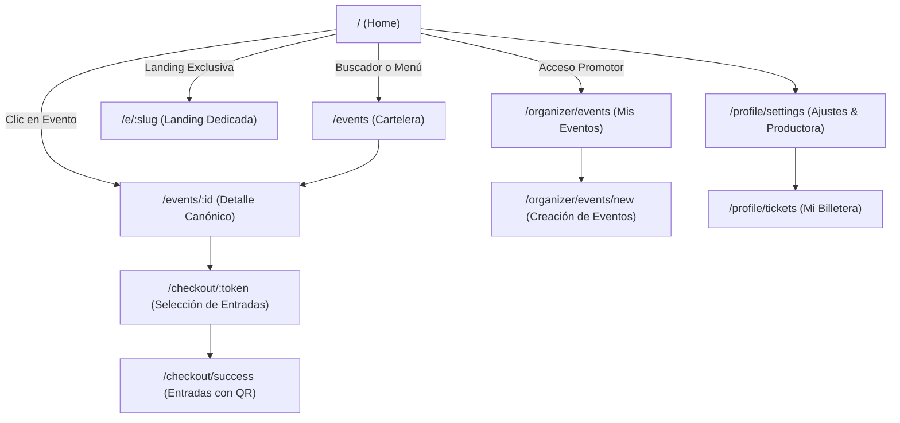
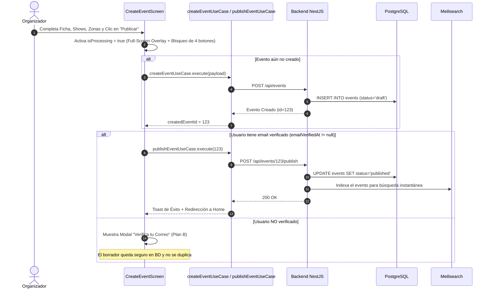
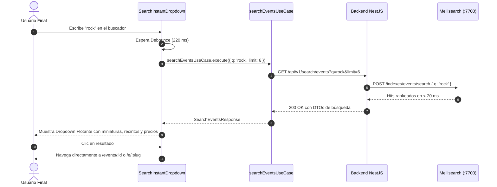

# Flujos de Navegación y Arquitectura Frontend - "Qué planes hoy"

Este documento describe la arquitectura de software, patrones de diseño, casos de uso y diagramas de flujo de la interfaz web en **Next.js** (App Router).

---

## 1. Arquitectura Frontend (Clean Architecture + DDD)

El frontend sigue los principios de **Clean Architecture** y manejo funcional de errores mediante la librería **`neverthrow`** (`Result` / `ResultAsync`).

```
[UI Components / Screens]
         │ (Invoca Casos de Uso)
         ▼
[Use Cases (Application)]
         │ (Interactúa mediante Contratos)
         ▼
[Repositories (Domain Interfaces)]
         │ (Implementado por)
         ▼
[Repository Implementations (Infrastructure)]
         │ (Delega llamadas HTTP)
         ▼
[ApiService / ApiClient (HTTP + Neverthrow)]
```

### Reglas de Oro Arquitectónicas:
1. **Los componentes de UI nunca consumen `fetch` ni `apiClient` directamente:** Siempre ejecutan un caso de uso (`searchEventsUseCase`, `createEventUseCase`, `publishEventUseCase`).
2. **Manejo Funcional con `neverthrow`:** Todo caso de uso retorna `ResultAsync<T, DomainError>`. La UI procesa los resultados mediante `.match((ok) => ..., (err) => ...)`, eliminando los bloques `try/catch` descontrolados.
3. **Desacoplamiento con Mappers:** Los DTOs recibidos de la API se mapean a modelos de dominio antes de ser expuestos a la interfaz visual.

---

## 2. Mapa de Rutas de la Aplicación



---

## 3. Flujo de Creación y Publicación de Eventos (`/organizer/events/new`)

Diseñado con blindaje total contra duplicados y garantía de correo verificado (**Plan B**).

### 3.1 Diagrama de Secuencia de Publicación



### 3.2 Blindaje Antidoble-sumisión
* **`isProcessing = isSaving || isPublishing`:** Deshabilita visual y funcionalmente los dos botones de "Guardar Borrador" y los dos botones de "Publicar Evento".
* **Full-Screen Loading Overlay:** Capa opaca con *backdrop-blur* y spinner que bloquea todo clic del puntero en la pantalla mientras se procesa la solicitud.
* **Idempotencia:** Si ya existe `createdEventId`, `handlePublish` no vuelve a crear el evento; procede directamente a su activación.

---

## 4. Flujo de Búsqueda Instantánea con Meilisearch

Integrado en [`desktop-header.tsx`](file:///d:/Personal/queplaneshoy/src/app/common/components/desktop-header.tsx) y en [`search-bar.tsx`](file:///d:/Personal/queplaneshoy/src/app/features/events/ui/components/search-bar.tsx).



---

## 5. Resumen de Estados de la UI

| Componente | Estado React | Comportamiento en Pantalla |
| :--- | :--- | :--- |
| **`CreateEventScreen`** | `isProcessing` | Activa Overlay oscuro no interactivo y deshabilita botones arriba y abajo. |
| **`CreateEventScreen`** | `showVerifyModal` | Se despliega si el organizador intenta publicar sin correo confirmado. |
| **`SearchInstantDropdown`** | `isOpen && results.length > 0` | Despliega lista flotante de tarjetas con foto R2, fecha y precio mínimo. |
| **`SearchInstantDropdown`** | `isLoading` | Muestra spinner circular en el extremo derecho del input. |
| **`SearchBar / ExplorePage`** | `publishedCities` | Al montar, consulta `getPublishedCitiesUseCase` y renderiza en el `<select>` solo las ciudades con eventos en estado `published` (`name (count)`). Evita mostrar departamentos sin eventos. |
| **`DesktopHeader`** | `shouldShowSearch` | En la Home en reposo, el centro del header permanece despejado para destacar el Hero. Al scrollear (o en páginas internas), activa la barra flotante `SearchInstantDropdown` con fade-in. |
| **`HeroCarousel`** | `slides` | Consume `getFeaturedEventsUseCase` con estrategia híbrida (máx 5 eventos). Enlaza dinámicamente a `/e/:slug` si tiene landing o `/events/:id` si es ficha regular. |
| **`LandingConfigManager`** | `hasLanding = true` | Inicializa automáticamente el slug amigable a partir del título del evento. |

