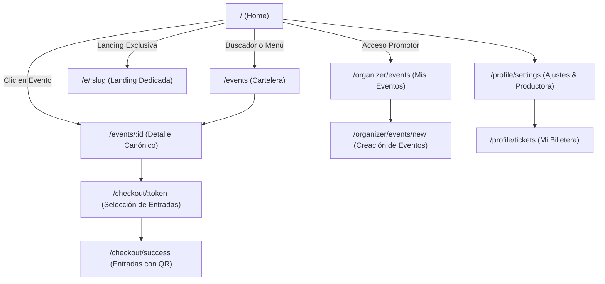
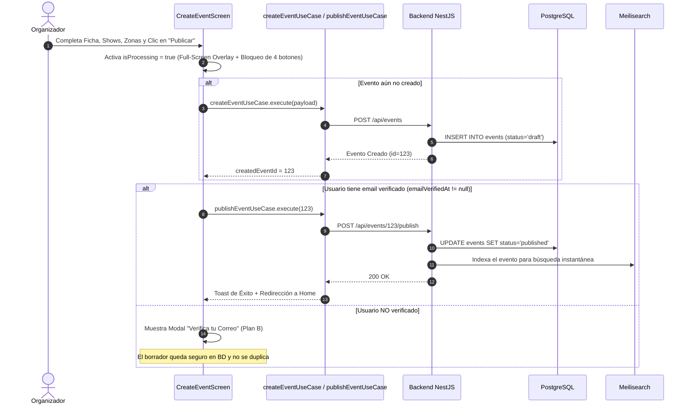
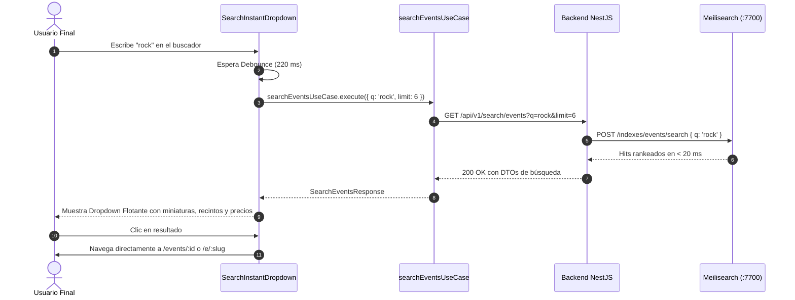

# Flujos de Navegación y Arquitectura Frontend - "Qué planes hoy"

Este documento describe la arquitectura de software, patrones de diseño, casos de uso y diagramas de flujo de la interfaz web en **Next.js** (App Router).

---

## 1. Arquitectura Frontend (Clean Architecture + DDD)

El frontend sigue los principios de **Clean Architecture** y manejo funcional de errores mediante la librería **`neverthrow`** (`Result` / `ResultAsync`).

```
[UI Components / Screens]
         │ (Invoca Casos de Uso)
         ▼
[Use Cases (Application)]
         │ (Interactúa mediante Contratos)
         ▼
[Repositories (Domain Interfaces)]
         │ (Implementado por)
         ▼
[Repository Implementations (Infrastructure)]
         │ (Delega llamadas HTTP)
         ▼
[ApiService / ApiClient (HTTP + Neverthrow)]
```

### Reglas de Oro Arquitectónicas:
1. **Los componentes de UI nunca consumen `fetch` ni `apiClient` directamente:** Siempre ejecutan un caso de uso (`searchEventsUseCase`, `createEventUseCase`, `publishEventUseCase`).
2. **Manejo Funcional con `neverthrow`:** Todo caso de uso retorna `ResultAsync<T, DomainError>`. La UI procesa los resultados mediante `.match((ok) => ..., (err) => ...)`, eliminando los bloques `try/catch` descontrolados.
3. **Desacoplamiento con Mappers:** Los DTOs recibidos de la API se mapean a modelos de dominio antes de ser expuestos a la interfaz visual.

---

## 2. Mapa de Rutas de la Aplicación



---

## 3. Flujo de Creación y Publicación de Eventos (`/organizer/events/new`)

Diseñado con blindaje total contra duplicados y garantía de correo verificado (**Plan B**).

### 3.1 Diagrama de Secuencia de Publicación



### 3.2 Blindaje Antidoble-sumisión
* **`isProcessing = isSaving || isPublishing`:** Deshabilita visual y funcionalmente los dos botones de "Guardar Borrador" y los dos botones de "Publicar Evento".
* **Full-Screen Loading Overlay:** Capa opaca con *backdrop-blur* y spinner que bloquea todo clic del puntero en la pantalla mientras se procesa la solicitud.
* **Idempotencia:** Si ya existe `createdEventId`, `handlePublish` no vuelve a crear el evento; procede directamente a su activación.

---

## 4. Flujo de Búsqueda Instantánea con Meilisearch

Integrado en [`desktop-header.tsx`](file:///d:/Personal/queplaneshoy/src/app/common/components/desktop-header.tsx) y en [`search-bar.tsx`](file:///d:/Personal/queplaneshoy/src/app/features/events/ui/components/search-bar.tsx).



---

## 5. Resumen de Estados de la UI

| Componente | Estado React | Comportamiento en Pantalla |
| :--- | :--- | :--- |
| **`CreateEventScreen`** | `isProcessing` | Activa Overlay oscuro no interactivo y deshabilita botones arriba y abajo. |
| **`CreateEventScreen`** | `showVerifyModal` | Se despliega si el organizador intenta publicar sin correo confirmado. |
| **`SearchInstantDropdown`** | `isOpen && results.length > 0` | Despliega lista flotante de tarjetas con foto R2, fecha y precio mínimo. |
| **`SearchInstantDropdown`** | `isLoading` | Muestra spinner circular en el extremo derecho del input. |
| **`SearchBar / ExplorePage`** | `publishedCities` | Al montar, consulta `getPublishedCitiesUseCase` y renderiza en el `<select>` solo las ciudades con eventos en estado `published` (`name (count)`). Evita mostrar departamentos sin eventos. |
| **`DesktopHeader`** | `shouldShowSearch` | En la Home en reposo, el centro del header permanece despejado para destacar el Hero. Al scrollear (o en páginas internas), activa la barra flotante `SearchInstantDropdown` con fade-in. |
| **`HeroCarousel`** | `slides` | Consume `getFeaturedEventsUseCase` con estrategia híbrida (máx 5 eventos). Enlaza dinámicamente a `/e/:slug` si tiene landing o `/events/:id` si es ficha regular. Si no hay destacados, realiza fallback dinámico a `getUpcomingEventsUseCase`. |
| **`LandingConfigManager`** | `hasLanding = true` | Inicializa automáticamente el slug amigable a partir del título del evento. |
| **`HomePage`** | `isLoadingUpcoming, isLoadingWeekly, isLoadingWeekend` | Controla de manera independiente los esqueletos (*Skeleton Loaders / Shimmers*) animados para cada sección de eventos. Si no hay eventos disponibles en base de datos, presenta un *Empty State* amigable sin romper la cuadrícula. |

---

## 6. Cartelera Dinámica del Home (`/`) sin Mocks

Toda la portada principal se encuentra 100% desvinculada de datos estáticos y sincronizada con el backend (PostgreSQL + Redis):

1. **`HeroCarousel`**:
   - `getFeaturedEventsUseCase`: Consulta hasta 5 eventos con `is_featured = true`.
   - **Fallback Dinámico**: Si ningún evento está marcado como destacado, toma automáticamente los primeros 3 eventos publicados desde `getUpcomingEventsUseCase`.
   - **Contingencia Institucional**: Si no existen eventos publicados en la base de datos, presenta el slide de bienvenida oficial de *Qué Planes Hoy* con enlace a `/events`.
2. **`Eventos Próximos`**:
   - Consume `getUpcomingEventsUseCase` ordenados cronológicamente a partir de las funciones más cercanas.
   - Renderiza esqueletos animados mientras espera la respuesta.
3. **`Eventos Destacados de la Semana`**:
   - Consume `getWeeklyFeaturedEventsUseCase` con selección editorial y eventos de alta demanda.
4. **`Planes para Este Fin de Semana`**:
   - Consume `getWeekendEventsUseCase` para eventos programados en el fin de semana próximo.
5. **Vista Móvil**:
   - El carrusel de destacados y la lista de próximos eventos se alimentan en tiempo real de los mismos datos vivos con filtrado reactivo por categorías oficiales.

---

## 7. Vinculación de Sesión Activa al Checkout y Emisión de Entradas

Para garantizar la integridad y titularidad de las compras:
1. **Frontend (`PurchaseFlowPage`)**:
   - Sincroniza el usuario autenticado activo desde `localStorage.getItem('qph_user')` y `getCurrentUserUseCase`.
   - En el Paso 2 de pago, muestra el bloque de titularidad con nombre y correo del comprador.
   - Envía el token JWT en el encabezado `Authorization: Bearer <token>` a través de `apiClient` junto a `customerEmail` y `customerName` del usuario logueado.
2. **Backend (`OrdersController` + `SimulateOrderCheckoutHandler`)**:
   - Extrae y valida criptográficamente el JWT mediante `TokenService` resolviendo el `id` interno del usuario en sesión.
   - Asocia directamente la orden en la tabla `orders` y los tickets emitidos en `tickets` al `userId` del comprador autenticado existente en PostgreSQL, sin crear cuentas duplicadas.

---

## 8. Sistema de Cupones de Descuento en Checkout (Stitch Design & Doble Check Atómico)

Integra la experiencia visual interactiva de Stitch con validación robusta de 6 casos de negocio y candado pesimista:

1. **Matriz de Casos de Negocio:**
   - **3 Ciclos de Vida / Vigencia:**
     - `single_use`: De un solo uso; al pagarse se quema e invalida (`is_active = false`, `used_count = 1`).
     - `reusable`: Reutilizable N veces; incrementa `used_count` hasta alcanzar `max_uses`, momento en el que se auto-invalida.
     - Vigencia por fecha y hora: Válido únicamente en el rango `starts_at <= NOW() <= expires_at`.
   - **2 Tipos de Beneficio Financiero:**
     - `percentage`: Porcentaje de descuento sobre el subtotal (`subtotal * (discountValue / 100)`).
     - `fixed`: Monto fijo directo en soles (`min(subtotal, discountValue)` con piso cero).
   - **Restricción de Monto Mínimo:** `min_order_amount <= subtotal`.

2. **Doble Validación (Paso 1/2 y Checkout Atómico):**
   - **Paso 1 y 2 (UI Reactiva):** El usuario ingresa el cupón en el resumen lateral; el frontend llama a `validateCouponUseCase.execute({ eventId, code, subtotal })`. Si es exitoso, la interfaz dibuja la pastilla verde con badge de descuento, recalcula dinámicamente el total ante cualquier cambio de entradas y ofrece botón de remoción.
   - **Paso 2 Final (Doble Check Atómico en Transacción):** Al pulsar "Confirmar y Pagar", se envía `couponCode` en el payload de `simulateCheckoutUseCase`. El backend ejecuta un bloqueo pesimista `SELECT ... FOR UPDATE` sobre la fila del cupón en PostgreSQL. Si otra compra concurrente consumió el último canje al mismo instante o el cupón expiró, la transacción hace rollback de inmediato con error `COUPON_INVALID_OR_EXPIRED`, evitando cualquier cobro indebido y alertando al usuario en pantalla para que continúe sin el cupón.

---

## 9. Pasarela de Pagos (Transición a Culqi)

> 💡 **Estado Actual:** Se ha removido completamente la integración previa con Izipay. El flujo de compra utiliza temporalmente `simulateCheckoutUseCase` para pruebas mientras se implementa la nueva integración oficial con **Culqi** (soporte nativo para Yape, Plin, Billeteras QR y Tarjetas).


