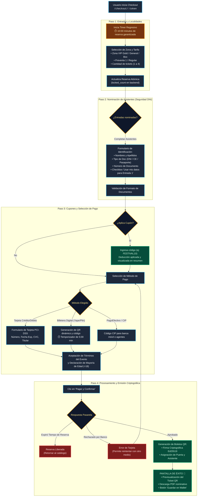

# Flujo de Experiencia de Usuario (UX) - Proceso de Compra y Acceso

Este documento detalla la experiencia integral de usuario en **Qué Planes Hoy**, cubriendo tanto la arquitectura general de compra como el flujo paso a paso de la pantalla de **Checkout y Emisión de Tickets**.

---

## 1. Diagrama de Flujo General: Desde el Descubrimiento hasta la Entrada al Evento

```mermaid
flowchart TD
    %% Estilos Generales
    classDef step fill:#1E293B,stroke:#38BDF8,stroke-width:2px,color:#F8FAFC;
    classDef decision fill:#0F172A,stroke:#F59E0B,stroke-width:2px,color:#FDE68A;
    classDef success fill:#064E3B,stroke:#10B981,stroke-width:2px,color:#D1FAE5;
    classDef alert fill:#7F1D1D,stroke:#EF4444,stroke-width:2px,color:#FEE2E2;
    classDef subg fill:#0F172A,stroke:#334155,stroke-width:1px,color:#94A3B8;

    %% FASE 1: DESCUBRIMIENTO Y EXPLORACIÓN
    subgraph F1 ["1. Descubrimiento y Exploración del Evento"]
        A["Usuario accede vía enlace o catálogo<br/><code>/e/:slug</code>"]:::step --> B{"¿Tiene Landing Page<br/>personalizada?"}:::decision
        B -->|"Sí (has_landing_page = true)"| C1["Visualiza Landing Inmersiva<br/>• Banner envolvente y colores de marca<br/>• Croquis interactivo de zonas<br/>• Botón CTA destacado"]:::step
        B -->|"No"| C2["Visualiza Ficha Estándar de Cartelera<br/>• Galería de fotos y sinopsis<br/>• Requisitos y restricción de edad"]:::step
        C1 --> D["Explora detalles del evento<br/>• Preguntas Frecuentes (FAQs)<br/>• Términos y condiciones (Texto o PDF)<br/>• Ubicación física y mapa"]:::step
        C2 --> D
        D --> E["(Opcional) Marca evento como Favorito ❤️"]:::step
    end

    %% FASE 2: SELECCIÓN DE ENTRADAS
    subgraph F2 ["2. Selección de Localidades y Tarifas"]
        E --> F["Selecciona Fecha y Función (Show)"]:::step
        D --> F
        F --> G["Elige Zona por Color distintivo<br/>(VIP, General, Boxes)"]:::step
        G --> H{"Estado de la Tarifa"}:::decision
        H -->|"Preventa Activa (Tier 1/2/3)"| I1["Muestra precio con descuento<br/>y precio regular tachado"]:::step
        H -->|"Preventa Agotada / Caducada"| I2["Muestra Precio Regular de lista"]:::step
        I1 --> J["Selecciona cantidad de boletos<br/>(Dentro del límite por checkout)"]:::step
        I2 --> J
        J --> K["Clic en 'Continuar al Checkout'"]:::step
    end

    %% FASE 3: RESERVA ATÓMICA Y CHECKOUT
    subgraph F3 ["3. Pantalla de Checkout y Reserva Temporal"]
        K --> L["Entradas quedan apartadas<br/>⏱️ Inicia temporizador de 10:00 min"]:::step
        L --> M["Revisa Resumen de Compra<br/>• Entradas reservadas y aforo asegurado<br/>• Subtotal y cargo por servicio"]:::step
        M --> N{"¿Tiene cupón de descuento?"}:::decision
        N -->|"Sí"| O1["Ingresa código de cupón<br/>(ej: FESTIVAL10)"]:::step
        O1 --> O2["Sistema valida y aplica rebaja<br/>Total actualizado con descuento"]:::step
        N -->|"No"| P["Verifica Términos y Condiciones<br/>(Modal interactivo o descarga PDF)"]:::step
        O2 --> P
        P --> Q["Clic en 'Pagar con Tarjeta / Billetera'"]:::step
    end

    %% FASE 4: PROCESAMIENTO DEL PAGO
    subgraph F4 ["4. Procesamiento Seguro del Pago"]
        Q --> R["Se abre pasarela bancaria segura<br/>⏱️ Sesión de cobro activa por 5:00 min"]:::step
        R --> S["Ingresa datos de tarjeta o escanea QR Yape"]:::step
        S --> T{"Resultado del Pago"}:::decision
        T -->|"Aprobado"| U1["Cobro confirmado exitosamente"]:::success
        T -->|"Rechazado (Fondos/Datos)"| U2["Muestra error de la tarjeta<br/>(Puede reintentar con otro medio dentro de sus 10 min)"]:::alert
        U2 --> S
        T -->|"Pérdida de red / Cierre de pestaña"| U3["Pago se procesa por detrás (Webhook)<br/>Entradas garantizadas en cuenta"]:::step
    end

    %% FASE 5: CONFIRMACIÓN Y ENTREGA
    subgraph F5 ["5. Confirmación y Entrega Digital"]
        U1 --> V["Pantalla de Éxito con Confeti 🎉"]:::success
        U3 --> V
        V --> W["Visualización inmediata de Boletos<br/>• Códigos QR firmados con Ed25519<br/>• Indicación de puerta y zona"]:::step
        W --> X1["Guardar en Apple Wallet / Google Wallet 📲"]:::step
        W --> X2["Descargar boletos en PDF 📄"]:::step
        W --> X3["Correo electrónico de respaldo recibido ✉️"]:::step
        W --> X4["Disponibles siempre en 'Mis Boletos' 🎫"]:::step
    end

    %% FASE 6: ACCESO EN PUERTA
    subgraph F6 ["6. El Día del Evento: Acceso en Puerta"]
        X1 --> Y["Asistente presenta boleto QR en su celular"]:::step
        X2 --> Y
        X4 --> Y
        Y --> Z["Personal de puerta escanea con App Móvil"]:::step
        Z --> AA{"Validación de Entrada"}:::decision
        AA -->|"Código válido y no utilizado"| BB1["PANTALLA VERDE + Sonido de Éxito<br/>🟢 'Pase VIP Autorizado'<br/>(scanned_at registrado)"]:::success
        AA -->|"Código ya escaneado previamente"| BB2["PANTALLA ROJA + Alerta Sonora<br/>🔴 'Boleto ya utilizado a las 19:42'"]:::alert
        AA -->|"Sin internet en recinto"| BB3["Validación Criptográfica Offline<br/>🟢 Firma válida confirmada localmente"]:::success
        BB1 --> CC["¡Ingreso al espectáculo! 🎪🎶"]:::success
        BB3 --> CC
    end
```

---

## 2. Diagrama Detallado: Flujo de la Pantalla de Compra (Checkout Step-by-Step)

---

## 3. Principios de UX/UI Aplicados al Checkout

1. **Sentido de Urgencia y Certeza (Fair Hold Timer):**
   - El temporizador regresivo de 10 minutos garantiza que nadie comprará el mismo boleto mientras el usuario llena sus datos, eliminando la frustración por colisiones de aforo.
2. **Nominación Fluida sin Fricción:**
   - La opción de un clic *"Copiar mis datos para el primer boleto"* ahorra hasta un 40% del tiempo de llenado en dispositivos móviles.
3. **Desglose de Costos Transparente (No Hidden Fees):**
   - El desglose lateral muestra con claridad el precio base, el cargo por servicio y el descuento exacto por cupones para generar confianza absoluta en el comprador.
4. **Respaldo Inmediato Multi-Canal:**
   - Una vez confirmada la compra, el asistente tiene 4 formas inmediatas de resguardar su acceso: visualización directa en pantalla, descarga PDF, agregarlo a Apple/Google Wallet y envío por correo electrónico.
