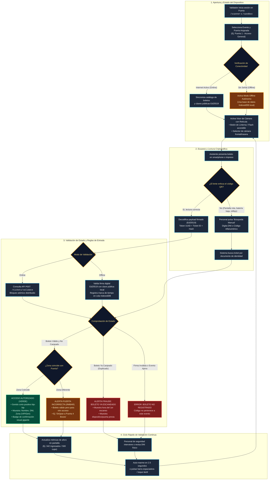

# Flujo de Experiencia de Usuario (UX) - Validación y Control de Acceso QR

Este documento detalla la arquitectura de experiencia de usuario (UX/UI) para el personal de puerta y control de acceso de **Qué Planes Hoy**. Describe cada paso desde la apertura de la cámara hasta la resolución de contingencias (modo offline, duplicados, búsqueda manual de boletos dañados).

---

## 1. Diagrama de Flujo de Validación de Boletos QR

---

## 2. Principios de UX/UI Aplicados al Control de Accesos

1. **Retroalimentación Cromática Instantánea (Split-Second Feedback):**
   - El personal de puerta procesa entre 10 y 20 personas por minuto.
   - El 90% de la pantalla cambia a color de alto impacto:
     - 🟢 **Verde Esmeralda (`#10b981`):** Ingreso autorizado.
     - 🔴 **Rojo Carmesí (`#ef4444`):** Entrada ya usada o fraudulenta.
     - 🟡 **Ámbar Intenso (`#f59e0b`):** Puerta incorrecta o advertencia.
2. **Ambiente de Luz Hostil y Modo Linterna:**
   - En festivales o discotecas no hay iluminación adecuada. La interfaz cuenta con botón flotante directo para encender la **Linterna (Torch)** y un modo de alto contraste oscuro para no encandilar al operario.
3. **Ergonomía Móvil con una Mano:**
   - Todos los controles primarios (Flash, Búsqueda Manual, Reanudar) están ubicados en el tercio inferior de la pantalla (zona natural del pulgar).
4. **Resiliencia Offline:**
   - La arquitectura garantiza validación en milisegundos incluso sin señal celular gracias a la firma digital **Ed25519**, sincronizando los accesos automáticamente cuando la red se restablezca.
5. **Detección Preventiva de Fraude:**
   - Si una persona intenta pasar con una captura de pantalla enviada por WhatsApp que ya ingresó, el sistema exhibe en rojo brillante la hora exacta del ingreso previo (`Ej: 21:14:02 hrs en Puerta 01`) permitiendo detectar el fraude al instante.
